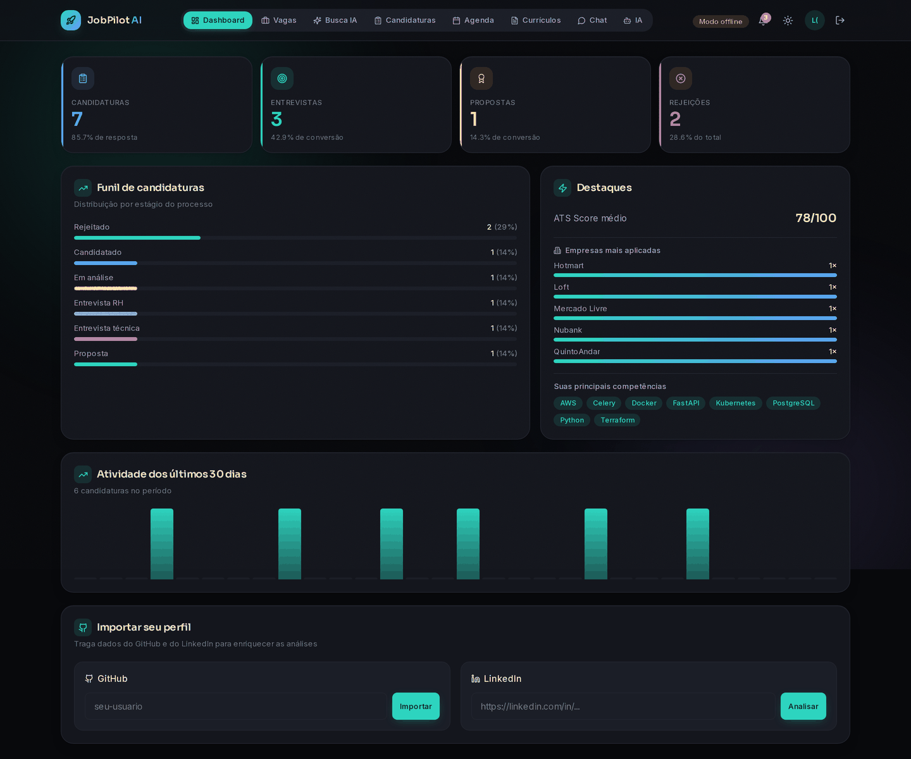
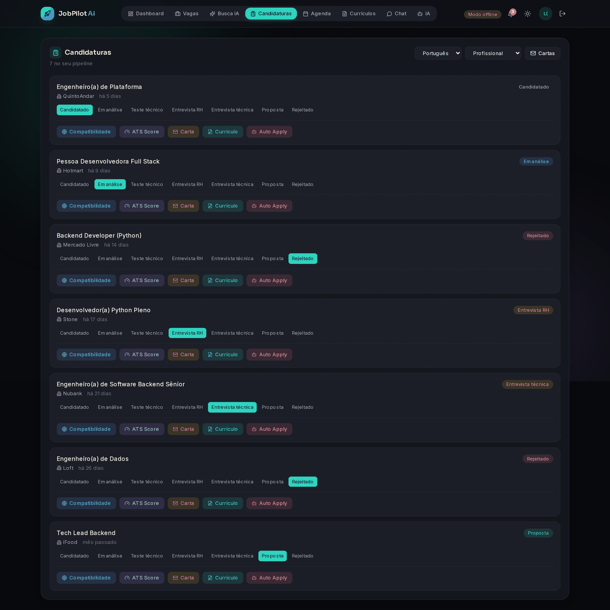
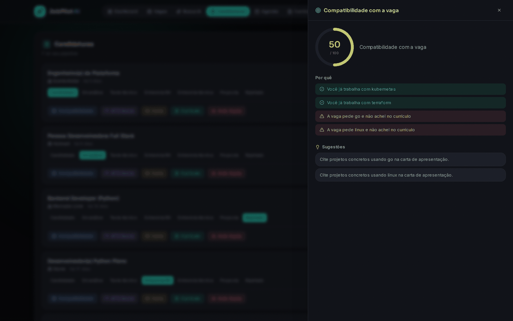
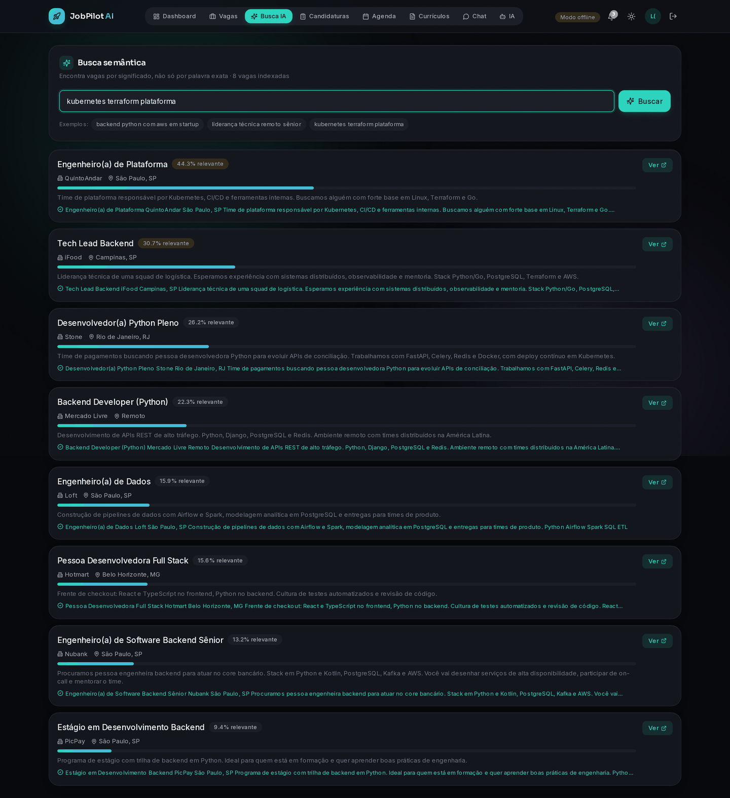
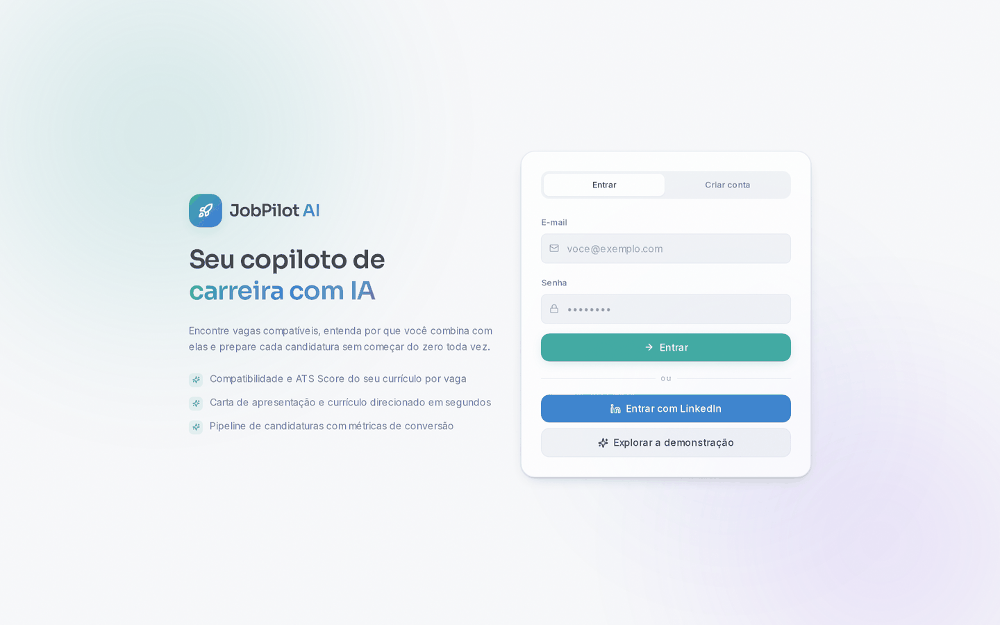

# JobPilot AI

Copiloto de carreira que encontra vagas compatíveis, avalia o currículo contra filtros
de ATS, gera cartas de apresentação e currículos direcionados, e acompanha o funil de
candidaturas.

**Funciona sem nenhuma chave de API.** Um analisador local cobre compatibilidade, ATS
Score, carta e currículo direcionado; configurar um provedor de LLM melhora a qualidade
e libera o chat aberto.

### ▶ [Abrir a demonstração](https://blackxzin.github.io/JOBPILOT_AI/)

Roda no navegador, sem instalar nada. É o frontend real, com as respostas da API
servidas a partir de dados capturados de uma instância rodando — dashboard, pipeline,
compatibilidade, ATS Score, cartas e busca semântica, todos funcionando de verdade.

Upload de currículo, busca em sites de vagas e chat precisam do backend. Para esses,
suba a stack completa — leva 2 minutos.

---

## Começar em 2 minutos

```bash
git clone https://github.com/blackxzin/JOBPILOT_AI.git
cd JOBPILOT_AI
cp .env.example .env
docker compose up -d
```

Abra `http://localhost:3000` e clique em **Explorar a demonstração**.

Isso cria uma conta com dados prontos — 8 vagas indexadas, 7 candidaturas em estágios
diferentes, agenda, notificações, um currículo com ATS Score e métricas reais no
dashboard. Nenhuma chave, nenhum cadastro, nenhum acesso a site de vagas.

| Serviço | Endereço local |
|---------|----------------|
| Frontend | `http://localhost:3000` |
| API | `http://localhost:8000` |
| Documentação da API | `http://localhost:8000/docs` |

Para desligar o modo demonstração, remova `DEMO_MODE=true` do `.env`. Ele é recusado
automaticamente quando `APP_ENV=production`.

```bash
# Recriar os dados da demonstração do zero
docker compose exec -e PYTHONPATH=/app/src -w /app/src backend \
  python -m scripts.seed_demo --reset
```

---

## A demonstração

Todas as telas abaixo são a conta de demonstração rodando **sem nenhuma chave de API**.
Os números vêm dos dados semeados; os scores e textos vêm do analisador local.

### Dashboard

Taxas de conversão, funil por estágio, empresas mais aplicadas, competências extraídas
do currículo e atividade dos últimos 30 dias.



### Candidaturas

Pipeline com sete estágios e as cinco ações de IA por candidatura.



### Análise de compatibilidade

Score, o porquê separado em pontos fortes e lacunas, e sugestões acionáveis.



### Busca semântica

Ranqueia por significado. `kubernetes terraform plataforma` encontra a vaga de
Engenheiro de Plataforma sem que o termo apareça no título.



### Entrada



---

## Modos de operação da IA

| Modo | Quando é usado | O que funciona |
|------|----------------|----------------|
| **Analisador local** | Nenhum provedor configurado (padrão) | Compatibilidade, ATS Score, carta, currículo direcionado, busca semântica |
| **Provedor de LLM** | Chave configurada em *IA* | Tudo acima com qualidade de modelo de linguagem, mais o chat de carreira |

O analisador local não é um mock: os scores vêm de sobreposição léxica real entre o
currículo e a vaga, e os textos são compostos a partir dos dados reais. É mais
formulaico que um LLM — nunca inventado.

Provedores suportados: OpenAI, Anthropic, Google Gemini, NVIDIA NIM, Ollama, OpenRouter.
As chaves são criptografadas com Fernet antes de irem para o banco.

---

## Funcionalidades

### Backend (FastAPI)

| Módulo | O que faz |
|--------|-----------|
| **Auth** | Registro, login, sessões com token, LinkedIn OAuth. Senhas com PBKDF2-HMAC-SHA256 (600k iterações), rate limit em login e registro |
| **Vagas** | Base local + RemoteOK, Jobicy, LinkedIn, Google Jobs, Indeed, Gupy, GeekHunter, Programathor |
| **Busca semântica** | Embeddings com API compatível com OpenAI ou vetorizador local; ranqueamento vetorizado em NumPy |
| **Currículos** | Upload de PDF com validação de assinatura e limite em streaming, extração de texto, ATS Score assíncrono |
| **IA** | Compatibilidade, ATS Score, carta de apresentação, currículo direcionado, auto apply, chat, posicionamento de perfil |
| **Candidaturas** | Pipeline com 7 estágios, estatísticas, verificação de posse em toda rota |
| **Agenda** | Entrevistas, prazos e lembretes |
| **Analytics** | Taxas de entrevista/proposta/rejeição/resposta, top empresas, top competências, série de 30 dias |
| **Notificações** | E-mail (Resend), Discord, Telegram — entregues por worker com retentativa |
| **Workers** | Ingestão agendada de vagas, matching em lote, ATS Score, entrega de notificações, auto apply |

### Frontend (Next.js 14 + React 18 + Tailwind)

Tema claro/escuro sem flash na primeira renderização, PWA instalável, responsivo,
navegação por teclado nos overlays e `prefers-reduced-motion` respeitado.

Telas: Dashboard, Vagas, Busca IA, Candidaturas, Agenda, Currículos, Chat, IA.

---

## Stack

| Camada | Tecnologia |
|--------|-----------|
| Frontend | Next.js 14, React 18, TypeScript, TailwindCSS |
| Backend | FastAPI, Python 3.12+ |
| Banco | PostgreSQL 16 |
| Cache / fila | Redis 7 |
| Workers | Celery + Celery Beat |
| Container | Docker Compose (6 serviços) |
| CI | GitHub Actions — lint, testes com cobertura mínima de 80%, build, varredura de segredos |
| Demo | GitHub Pages, publicada a cada push (`.github/workflows/demo.yml`) |

---

## Desenvolvimento local

**Backend**

```bash
cd apps/backend
python -m venv .venv && source .venv/bin/activate
pip install -r requirements-dev.txt
alembic upgrade head
uvicorn src.main:app --reload --port 8000
```

**Frontend**

```bash
cd apps/frontend
npm install
npm run dev
```

**Testes**

```bash
cd apps/backend
PYTHONPATH=src pytest -q                                  # 187 testes
PYTHONPATH=src pytest --cov=src --cov-report=term-missing # cobertura, mínimo 80%
ruff check src tests                                       # lint

cd apps/frontend
npm run type-check && npm run lint && npm run build
```

---

## Endpoints

Prefixo `/api/v1`. Documentação interativa em `/docs`.

| Área | Rotas |
|------|-------|
| Auth | `POST /auth/register` · `POST /auth/login` · `POST /auth/demo` · `POST /auth/logout` · `GET /auth/me` · `GET /auth/linkedin/login` · `GET /auth/linkedin/callback` |
| Vagas | `GET /jobs` · `POST /jobs` · `GET /jobs/{id}` · `GET /jobs/{fonte}` · `GET /jobs/search-all` |
| Busca | `GET /search/semantic` · `POST /search/index-job/{id}` |
| IA | `POST /ai/match` · `/ai/ats-score` · `/ai/cover-letter` · `/ai/tailor-resume` · `/ai/auto-apply` · `/ai/chat` · `/ai/github/import` · `/ai/linkedin/analyze` |
| Currículos | `POST /resumes/upload` · `GET /resumes/list` · `GET /resumes/{id}` |
| Candidaturas | `POST /applications` · `GET /applications/list` · `GET /applications/stats` · `PATCH /applications/{id}/status` |
| Cartas | `POST /cover-letters/generate` · `GET /cover-letters` · `GET|PATCH|DELETE /cover-letters/{id}` |
| Agenda | `GET|POST /calendar` · `PATCH|DELETE /calendar/{id}` |
| Analytics | `GET /analytics/overview` |
| Notificações | `GET /notifications` · `GET /notifications/unread-count` · `PATCH /notifications/{id}/read` |
| Config | `GET /settings/providers` · `GET|POST /settings/llm` |
| Saúde | `GET /health` (liveness) · `GET /health/ready` (banco + Redis) · `GET /api/v1/meta` |

---

## Configuração

Tudo em `.env` (veja `.env.example`). O essencial:

| Variável | Padrão | Observação |
|----------|--------|-----------|
| `APP_ENV` | `development` | Em `production` o boot é recusado com `SECRET_KEY` padrão, `DEBUG=true` ou `DEMO_MODE=true` |
| `SECRET_KEY` | inseguro | Deriva a chave que criptografa as chaves de API. Gere: `python -c "import secrets;print(secrets.token_urlsafe(48))"` |
| `DEMO_MODE` | `false` | Semeia a conta de demonstração e habilita `POST /auth/demo` |
| `LLM_TIMEOUT_SECONDS` | `60` | Teto por chamada de LLM |
| `EMBEDDING_API_KEY` | vazio | Vazio usa o vetorizador local |
| `NVIDIA_NIM_MODEL` | `meta/llama-3.3-70b-instruct` | Provedores hospedados descontinuam modelos; confira em build.nvidia.com |
| `RATE_LIMIT_ENABLED` | `true` | Limites por IP em login, registro e OAuth |
| `SENTRY_DSN` | vazio | Preenchido, ativa o Sentry |
| `POSTGRES_HOST_PORT` | `5433` | Porta no host, para não colidir com um Postgres local |

---

## Deploy

Guias em `infra/coolify/README.md` e `infra/railway/README.md`.
O compose de produção está em `infra/coolify/docker-compose.prod.yml`.

Antes de subir:

1. Defina `APP_ENV=production` e um `SECRET_KEY` único de 32+ caracteres.
2. Deixe `DEMO_MODE` desligado.
3. Rode `alembic upgrade head`.
4. Aponte o health check do orquestrador para `/health/ready`.

---

## Licença

MIT

Feito por [Lucas Oliver](https://github.com/blackxzin)
